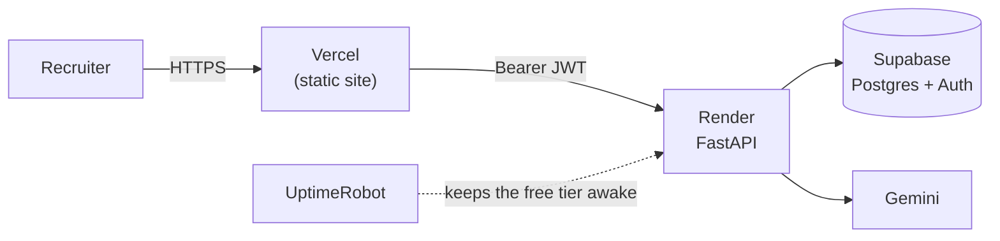
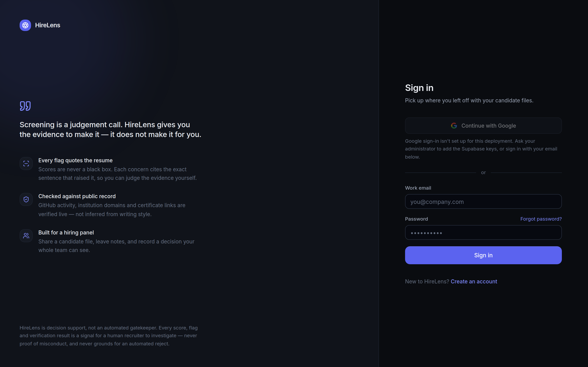

# Deployment

Three services, one afternoon. Supabase holds the data and the accounts,
Render runs the API, and Vercel serves the frontend (any static host works —
see section 3). Every piece can start on a free plan; **[Running at
₹0](#5--running-at-0)** says exactly what each free plan gives you and where it
runs out.



### Launch checklist — Render + Vercel

Production deploys from `main` on both services, so a change does nothing
until it is merged there. Then, in this order:

1. **Supabase** — run every file in `backend/sql` that has not been run yet
   (section 1). Files are idempotent; re-running one is harmless.
2. **Render** (the API service → *Environment*) — check these are set:
   `ADMIN_EMAILS` (your sign-in email), `LLM_PROVIDER_ORDER=groq,gemini,anthropic`
   if you are on Gemini's free tier, `GROQ_API_KEY`, `FREE_MONTHLY_ANALYSES`
   (e.g. `20`), `BACKEND_URL` (the service's own URL). The model names have
   working defaults; only set `GEMINI_MODEL` / `GROQ_MODEL` to override them.
3. **Vercel** (project → *Settings → Environment Variables*) — the legal-page
   variables (section 2, *Legal pages*), including
   `NEXT_PUBLIC_WEBSITE_HOST=Vercel`. `NEXT_PUBLIC_API_URL` is already there.
   Then redeploy: these are baked into the build.
4. **Verify** — `curl https://<api>.onrender.com/api/v1/health` must show
   `"database": "ok"` and `"schema": "ok"`. `"missing_migrations"` means step
   1 is incomplete; the Render log line starting `DATABASE IS MISSING
   MIGRATIONS` names the files. Then walk the app once (end of *Verifying the
   deployment*).

---

## 1 · Supabase

Create a project, then run these files in the **SQL Editor**, in order.
Every statement is idempotent, so re-running the set is a no-op rather than an
error.

| Order | File | Creates |
|:--:|---|---|
| 1 | `backend/sql/001_core_schema.sql` | `reports` with the indexes the dashboard's filters and sorts need, `profiles` with its trigger and backfill |
| 2 | `backend/sql/002_team_collaboration.sql` | `teams`, `team_members`, `team_invites`, `report_comments`, `report_votes`, `reports.team_id` |
| 3 | `backend/sql/003_candidate_notifications.sql` | the `candidate_notified_*` columns |
| 4 | `backend/sql/004_normalize_invite_emails.sql` | one spelling for an invited address, so an invite always matches the person who was invited |
| 5 | `backend/sql/005_saved_job_descriptions.sql` | `saved_jds`, so a role's description is written once and reused |
| 6 | `backend/sql/006_index_and_policy_tuning.sql` | indexes and policy rewrites the Supabase advisors flag |
| 7 | `backend/sql/007_billing_and_usage.sql` | `subscriptions` and the `usage_events` ledger behind plan quotas — writable only by the API |
| 8 | `backend/sql/008_sessions_and_invite_fk.sql` | `session_revocations` (password reset and "sign out of all devices" end old sessions), and a fix that let a user who had sent a team invite be deleted |

**002 must come after 001** — it adds a column to `reports` and foreign-keys
four tables to it.

The API checks this itself: at startup it probes every table and column it
uses and, if any is missing, logs `DATABASE IS MISSING MIGRATIONS` at CRITICAL
with the file to run and what stops working without it (without `007`, for
instance, usage is not recorded and plan limits are not enforced). `/health`
reports the result as `services.schema`. Files `004`, `006` and the
foreign-key part of `008` change data, indexes or constraints, which cannot be
seen this way — run them anyway.

Or verify from the SQL Editor:

```sql
select table_name from information_schema.tables
where table_schema = 'public' order by table_name;
-- profiles, report_comments, report_votes, reports, saved_jds, session_revocations,
-- subscriptions, team_invites, team_members, teams, usage_events
```

### Why `profiles` exists

Supabase keeps users in `auth.users`, which PostgREST does not expose. Comment
threads, team rosters and the signature on candidate emails all need to turn a
user id into a person, so `001` mirrors the readable fields into
`public.profiles`, keeps them in step with a trigger on `auth.users`, and
backfills anyone who signed up earlier. Without it every teammate shows as a
neutral badge and candidate emails go out signed with the recruiter's raw
email address.

### Turn on leaked-password protection

Free, one toggle, and it blocks the passwords that actually get used in
credential-stuffing runs:

1. Supabase dashboard → your project
2. **Authentication** → **Policies** (older UI: **Providers → Email**)
3. Find **Leaked password protection** and switch it **on**
4. Optionally raise **Minimum password length** to 10 and require mixed
   character classes

Supabase then checks new passwords against HaveIBeenPwned using a k-anonymity
prefix — the password itself never leaves Supabase. Confirm it took with
`get_advisors` or the **Advisors → Security** page; the warning disappears.

### Allow the password reset page to be redirected to

**Required.** Without it, password reset is a dead end.

When someone asks to reset their password, the API tells Supabase to send them
to `https://<your-frontend>/reset-password`. Supabase only honours that if the
URL is on its allowlist — otherwise it quietly sends the recovery token to the
project's Site URL instead, where nothing reads it, and the person ends up
staring at the dashboard with no way to continue.

1. Supabase dashboard → **Authentication** → **URL Configuration**
2. Set **Site URL** to your frontend origin, e.g. `https://your-site.pages.dev`
3. Under **Redirect URLs**, add:
   - `https://<your-frontend>/reset-password`
   - `https://<your-frontend>/**` if you also deploy previews

The same page governs where a Google sign-in and an email confirmation land,
so it is worth getting right once.

#### About the emails themselves

Supabase's built-in SMTP is rate-limited to a handful of messages per hour and
is documented as being for development only. For real users, set a custom SMTP
provider under **Authentication → Emails → SMTP Settings**, or the reset emails
your customers ask for will silently stop arriving on a busy day.

Deployments running **without** Supabase send this email themselves, through
`RESEND_API_KEY` or the `SMTP_*` variables. With neither configured the token
is still created but nothing carries it, so the request is logged at ERROR
level rather than passing quietly — check the Render logs for
"no email provider accepted the message" if resets are not arriving.

### Google sign-in

**Authentication → Providers → Google.** You need a Google Cloud OAuth client
(Web application), with Supabase's callback URL — shown on that same page —
added to *Authorised redirect URIs*. Paste the client id and secret into
Supabase.

The API reports its half of the readiness at `GET /api/v1/health` as
`google_auth_ready`, and the frontend hides the button when it is false rather
than showing one that fails at the verification step.

<div align="center">

</div>

---

## 2 · Render — the API

`render.yaml` is in the repo. Point Render at the fork and set these:

| Variable | Required | Notes |
|---|:--:|---|
| `SECRET_KEY` | ✅ | 32+ random characters. Signs the session JWTs |
| `GEMINI_API_KEY` | ✅ | Free at [aistudio.google.com](https://aistudio.google.com) |
| `SUPABASE_URL` | ✅ | `https://<ref>.supabase.co` |
| `SUPABASE_SERVICE_KEY` | ✅ | **service_role**, never the anon key. Server-side only |
| `SUPABASE_ANON_KEY` | ✅ | Public key, used for the OAuth round trip |
| `FRONTEND_URL` | ✅ | Your frontend's URL (section 3). Invite and password-reset emails link here; unset, they link to a built-in default that is not your site (logged at CRITICAL on boot) |
| `ADMIN_EMAILS` | ✅ | Comma-separated sign-in emails of operators. Only they can read `/health/diagnostics` and `/auth/stats` and change a customer's plan; in production nobody can until this is set |
| `ALLOWED_ORIGINS` | ✅ | Your frontend's URL, comma-separated for several |
| `APP_ENV` | ✅ | `production` |
| `TRUSTED_PROXY_HOPS` | ➖ | Proxies in front of the app. `1` (the default) is right for Render; `2` behind Cloudflare; `0` with no proxy |
| `GITHUB_TOKEN` | ➖ | Lifts GitHub verification from 60 to 5,000 requests/hour |
| `GROQ_API_KEY` | ➖ | Second LLM provider |
| `ANTHROPIC_API_KEY` | ➖ | Third LLM provider |
| `RESEND_API_KEY` | ➖ | Candidate and invite emails. On Render's **free** plan this is the only way the API can send mail — see *Email* in section 5 |
| `SMTP_FROM_EMAIL` | ➖ | Sender address. **Required with Resend**: it must be on a domain you have verified there, or every send is rejected |
| `FREE_MONTHLY_ANALYSES` / `PRO_…` / `TEAM_…` | ➖ | Completed analyses per calendar month on each plan. `0` (default) = unlimited — see *Plans and quotas* below |
| `UPGRADE_URL` | ➖ | Where the in-app **Upgrade** button goes: a payment link, a pricing page, or a `mailto:` |
| `GEMINI_MODEL` | ➖ | Ordered fallback list, default `gemini-3.8-flash,gemini-3.6-flash,gemini-3.5-flash-lite` — all three free of charge on the free tier, none with a shutdown date. `gemini-4-hydrogen` is also free but six days old at the time of writing; test it with your key before putting it first. Do not use `gemini-2.5-*`: since September 2026 Google serves those only to projects that already used them, so a new project gets a 404 on every call |
| `GROQ_MODEL` | ➖ | Default `openai/gpt-oss-120b`. `llama-3.3-70b-versatile` was shut down for free and developer keys on 16 Aug 2026 |
| `ANTHROPIC_MODEL` | ➖ | Default `claude-sonnet-5-5` |
| `GEMINI_THINKING_LEVEL` | ➖ | Gemini 3.x reasoning depth: `minimal`, `low` (default), `medium`, `high`, or empty for the model default. A model that rejects the level is retried with its default |
| `LLM_PROVIDER_ORDER` | ➖ | Which provider is asked first, default `gemini,groq,anthropic`. **Read *Candidate data and free AI tiers* below** |
| `MAX_REGISTERED_USERS` | ➖ | Hard ceiling on accounts (default 5000). `0` = none |
| `REDIS_URL` | ➖ | Shared rate limits and batches across instances |

> **Get `TRUSTED_PROXY_HOPS` right.** Rate limits are keyed on the caller's
> IP, which behind a proxy comes from `X-Forwarded-For` — a header the caller
> also sets. Each proxy appends the address it saw, so only that many entries
> from the right are evidence. Setting it too high keys everyone to the same
> proxy address; too low, and a caller can change the header per request.
> Render is one hop.

> **The service key must never reach a browser.** It bypasses row-level
> security entirely. Put it on Render only — never on the frontend host, and never in any
> `NEXT_PUBLIC_*` variable, which is inlined into the JavaScript bundle every
> visitor downloads.

### The GitHub token

A **fine-grained** token with **Public repositories (read-only)** and **no
permissions granted** is enough — verification only reads public data. A
classic token with zero scopes behaves identically. Either takes the rate
limit from 60 requests/hour to 5,000.

### Free-tier durability

The container filesystem is ephemeral and the free plan replaces the container
on every deploy *and* every wake from sleep. With Supabase configured this does
not matter — Postgres is the store. Without it, the SQLite fallback is erased
along with every account and report in it.

For a persistent disk instead, change `plan: free` to `plan: starter` and
uncomment the `disk:` block. **Adding that block while `plan: free` is set
makes the deploy fail** — disks are not available on the free plan.

---

### Candidate data and free AI tiers

Every resume is a candidate's personal data, and it is sent to an AI provider
to be analysed. The providers' data terms differ, and the difference matters
for India's DPDP Act, GDPR and your customers' contracts:

| Provider | Uses API content to improve its models? |
|---|---|
| Gemini API, **free tier** (outside EEA/UK/Switzerland) | **Yes** — Google may use it to improve products, and human reviewers may read it. Google advises against sending personal information |
| Gemini API, **paid tier** (billing enabled on the project) | No |
| Groq | No, and nothing is retained by default |
| Anthropic API | No |

Before taking real customers, either **enable billing on the Gemini project**
(Flash-Lite costs well under a cent per resume) or set
`LLM_PROVIDER_ORDER=groq,gemini,anthropic` so Groq handles resumes and Gemini's
free tier is only a fallback. The privacy policy at `/privacy` names these
sub-processors.

### Legal pages

The frontend serves `/privacy`, `/terms`, `/refunds` and `/contact`, linked
from sign-in, sign-up and the account menu. Payment providers (Stripe,
Razorpay) require these before activating an account. Set them on the
**frontend host** (section 3), then redeploy the frontend:

```env
NEXT_PUBLIC_COMPANY_NAME=Your Company Pvt Ltd
NEXT_PUBLIC_CONTACT_EMAIL=support@yourcompany.com
NEXT_PUBLIC_COMPANY_ADDRESS=Registered address
NEXT_PUBLIC_GOVERNING_LAW=the laws of India, courts of <city>
NEXT_PUBLIC_REFUND_WINDOW_DAYS=14
NEXT_PUBLIC_LEGAL_EFFECTIVE_DATE=1 December 2026
NEXT_PUBLIC_WEBSITE_HOST=Cloudflare   # named in the privacy policy
```

Until the name and email are set, each page shows a "Template — not yet in
force" banner. The text describes what the code actually does with data, but
it is a starting point: have it reviewed by a lawyer for your jurisdiction.

### Plans and quotas

Every resume that produces a report is one **analysis**, whichever page it came
from. A failed analysis is never counted. Usage is recorded in an append-only
ledger (`usage_events`) that no user-reachable path can delete from — deleting
reports does not hand quota back.

Quotas are **off by default** (`0` = unlimited), so deploying this changes
nothing. To turn them on, set the limits and redeploy:

```env
FREE_MONTHLY_ANALYSES=25
PRO_MONTHLY_ANALYSES=500
TEAM_MONTHLY_ANALYSES=2500
UPGRADE_URL=https://buy.stripe.com/your-payment-link
```

(The numbers are examples — pricing is your call.) Customers see their usage in
the sidebar, and an upload over the limit is refused with HTTP **402** and a
message saying how many are left. The limit resets on the 1st of each month, UTC.

**Upgrading a customer after they pay.** Payment collection is not wired to a
provider yet, so an operator listed in `ADMIN_EMAILS` records the upgrade:

```bash
API=https://<your-api>.onrender.com
# Sign in as an operator (an address listed in ADMIN_EMAILS) to get a token:
TOKEN=$(curl -s -X POST $API/api/v1/auth/login -H "Content-Type: application/json" \
  -d '{"email": "you@yourcompany.com", "password": "…"}' | jq -r .access_token)

curl -X POST $API/api/v1/billing/admin/plan \
  -H "Authorization: Bearer $TOKEN" \
  -H "Content-Type: application/json" \
  -d '{"email": "customer@company.com", "plan": "pro"}'
```

It takes effect on the customer's next upload. To downgrade, send `"free"`.

---

## 3 · The frontend — a static site

The frontend is built as plain files (`next build` writes `frontend/out/`):
every page talks to the API from the browser, so no Node server runs in
production and any static host can serve it. Pick **one** host.

Whichever you pick, set these in its environment variables **before the first
build** — they are baked into the pages, so changing one needs a redeploy:

| Variable | Required | Notes |
|---|:--:|---|
| `NEXT_PUBLIC_API_URL` | ✅ | The API's public URL, e.g. `https://hirelens-api.onrender.com`. On Cloudflare Pages, Netlify, Render and Vercel the build **fails** without it, rather than ship a site that calls the visitor's own computer |
| `NODE_VERSION` | ✅ | `22`. Next.js 16 needs Node 20.9 or newer. Already set in `netlify.toml` and the Render snippet below; set it yourself on Cloudflare Pages |
| `NEXT_PUBLIC_SUPABASE_URL` / `NEXT_PUBLIC_SUPABASE_ANON_KEY` | ➖ | Only for Google sign-in |
| `NEXT_PUBLIC_COMPANY_NAME` … `NEXT_PUBLIC_WEBSITE_HOST` | ➖ | The legal pages — see *Legal pages* above |

Then put the site's URL in `ALLOWED_ORIGINS` **and** `FRONTEND_URL` on Render
and redeploy the API. Anything named `NEXT_PUBLIC_*` ships to the browser, so
nothing secret goes here.

### Vercel

The project needs **Root Directory** `frontend` and the Next.js framework
preset — nothing else; Vercel recognises the static export by itself.
`frontend/vercel.json` adds the security headers. Production deploys from
`main`; every other branch gets a preview deployment.

**Vercel's free Hobby plan is for non-commercial use only.** Running a paid
product on it is against Vercel's terms and risks the project being
suspended. Before you take payments, either move to Vercel Pro or move the
frontend to Cloudflare Pages (free, below) — the same build works on both,
so switching is a settings change, not a code change.

### Cloudflare Pages (free)

Workers & Pages → Create → Pages → *Import an existing Git repository*:

| Setting | Value |
|---|---|
| Framework preset | Next.js (Static HTML Export) |
| Root directory | `frontend` |
| Build command | `npm run build` |
| Build output directory | `out` |

Cloudflare's free-plan limits page lists 500 builds a month, one build at a
time and 20,000 files per site (this site has a few hundred), and lists **no
bandwidth limit**. The response headers in `frontend/public/_headers` are
applied automatically.

### Netlify

`netlify.toml` at the repository root already sets the base directory,
build command, publish directory and Node version: import the repository and
add the environment variables. Netlify's Next.js adapter recognises a static
export and publishes `out/` with its `_headers` file.

The free plan is **300 credits a month with a hard limit**: a production
deploy costs 15 credits, 1 GB of traffic 20, and 10,000 requests 2. That is
plenty of traffic for an early product, but every push to the production
branch is a deploy — twenty pushes in a month use the whole allowance.

### Render static site

Static sites on Render are free and do not use the API's instance hours, but
on the free (Hobby) workspace they **share the API's 5 GB a month of
bandwidth**. Fine to start with; move to Cloudflare Pages if the dashboard
shows bandwidth climbing. It is not in `render.yaml` by default — a blueprint
sync would otherwise create it for everyone, and its build fails until
`NEXT_PUBLIC_API_URL` is set. To use it, append this under `services:` in
`render.yaml` (paths are relative to the repository root, which is what
`staticPublishPath` always is):

```yaml
  - type: web
    name: hirelens-web
    runtime: static
    buildCommand: cd frontend && npm ci && npm run build
    staticPublishPath: ./frontend/out
    buildFilter:
      paths:
        - frontend/**
    # Same set as frontend/public/_headers. The Content-Security-Policy
    # itself is a <meta> tag in every page; only frame-ancestors has to be
    # a header.
    headers:
      - path: /*
        name: Content-Security-Policy
        value: frame-ancestors 'none'
      - path: /*
        name: X-Frame-Options
        value: DENY
      - path: /*
        name: X-Content-Type-Options
        value: nosniff
      - path: /*
        name: Referrer-Policy
        value: strict-origin-when-cross-origin
      - path: /*
        name: Permissions-Policy
        value: camera=(), microphone=(), geolocation=(), payment=()
      - path: /*
        name: Strict-Transport-Security
        value: max-age=31536000
      - path: /_next/static/*
        name: Cache-Control
        value: public, max-age=31536000, immutable
    routes:
      # Reports used to live at /report/<id>. Render applies a rule only
      # when no file exists at the path, so the report page's own files under
      # /report/ (index.txt, __next.*.txt) are never redirected. Other hosts
      # get the same forwarding from the 404 page (LegacyReportRedirect).
      - type: redirect
        source: /report/:id
        destination: /report/?id=:id
    envVars:
      # Next.js 16 needs Node 20.9 or newer.
      - key: NODE_VERSION
        value: "22"
      # The API's public URL, e.g. https://hirelens-api.onrender.com.
      # Required: the build fails without it rather than ship a site that
      # cannot reach its API.
      - key: NEXT_PUBLIC_API_URL
        sync: false
      # Optional, for Google sign-in.
      - key: NEXT_PUBLIC_SUPABASE_URL
        sync: false
      - key: NEXT_PUBLIC_SUPABASE_ANON_KEY
        sync: false
```

### Links into the app

A report's address is `/report/?id=<id>` — one page for every report, since a
static site has no server to generate a page per id. Old `/report/<id>` links
(bookmarks, earlier emails) still work: they reach the 404 page, which
forwards them. Check a deployment with `npm run build && npm start` in
`frontend/` — `npm start` serves `out/` the way these hosts do, headers
included.

---

## 4 · Keeping the free tier awake

Render's free plan sleeps after 15 minutes without inbound traffic, and
waking takes about a minute — long enough that a recruiter thinks the app is
broken. Point
[UptimeRobot](https://uptimerobot.com) (or any monitor) at:

```
https://your-api.onrender.com/api/v1/health
```

every 5 minutes. The health check reads one row from the database, so the
same ping also counts as activity for Supabase, whose free projects pause
after a week without any. That endpoint is deliberately cheap and deliberately says
*whether* each service is well without saying *why* — a Postgres error
routinely names the host or the schema, and this is the one route reachable
without an account. The detail is in the logs and in
`/api/v1/health/diagnostics`, which requires a token.

---

## 5 · Running at ₹0

Everything above can run without paying anything. This is what each free plan
actually gives you, what happens when it runs out, and what to pay for first.
Figures are from each provider's own pages as of November 2026; they change, so
check the source before relying on one: Render
[free plan](https://render.com/docs/free) and [pricing](https://render.com/pricing),
[Cloudflare Pages limits](https://developers.cloudflare.com/pages/platform/limits/),
[Netlify credit plans](https://docs.netlify.com/manage/accounts-and-billing/billing/billing-for-credit-based-plans/credit-based-pricing-plans/),
[Gemini rate limits](https://ai.google.dev/gemini-api/docs/rate-limits),
[Groq rate limits](https://console.groq.com/docs/rate-limits),
[Resend pricing](https://resend.com/pricing).

| Piece | Free plan | When it runs out |
|---|---|---|
| **API** — Render free web service | 750 instance hours per workspace per month (one always-on service uses ~744). Sleeps after 15 min idle, ~1 min to wake. Container disk erased on every deploy and wake. **Cannot send email over SMTP** (ports 25, 465 and 587 are blocked). The Hobby workspace includes 5 GB of outbound bandwidth a month | Over the bandwidth: billed if a card is on file, otherwise **every free service in the workspace is suspended for the rest of the month** |
| **Frontend** — Vercel Hobby | **Non-commercial use only** under Vercel's terms; usage limits are on Vercel's pricing page | — move to Pro, or to Cloudflare Pages, before charging customers |
| **Frontend** — Cloudflare Pages (alternative) | 500 builds a month, 20,000 files per site, no bandwidth limit listed. Whether its free plan allows commercial use is not stated on the Cloudflare pages linked here — check its terms | No new builds for the rest of the month |
| **Database + sign-in** — Supabase free | Pauses after a week with no activity (the uptime ping in section 4 counts as activity) | Paused projects must be resumed from the dashboard |
| **AI** — Gemini API free tier | Limits are **per Google Cloud project, not per key**, and daily limits reset at midnight Pacific. Google does not publish fixed numbers for every model: see yours in AI Studio → *Rate limit* | HTTP 429; the API falls through to the next provider in `LLM_PROVIDER_ORDER` |
| **AI** — Groq free (`openai/gpt-oss-120b`) | 30 requests/min, 1,000/day, 8,000 tokens/min, 200,000 tokens/day | Same: next provider |
| **Email** — Resend free | 3,000 emails a month, 100 a day; needs a **domain you own**, verified with Resend | HTTP 429; the app reports the email as not sent |

Render itself says free instances are for testing and hobby projects, not
production. Launching on them is reasonable; the first thing to pay for is the
API instance — Render's smallest paid instance ($7 a month on the pricing page)
never sleeps.

### How many resumes a day the free AI tiers cover

Each resume is two AI calls (extraction, then analysis). Groq's free limits
— 8,000 tokens a minute, 200,000 a day — work out to very roughly a dozen to
two dozen resumes a day, depending on resume length (an estimate, not a
measured figure). Gemini's free tier adds more on top; how much depends on the
limits AI Studio shows for your project. **These limits are shared by every
user of your deployment**, so one customer uploading a batch of fifty can use
up a day's capacity for everyone. Set a per-account monthly limit before
inviting anyone:

```env
FREE_MONTHLY_ANALYSES=20      # example; size it to your daily AI capacity
MAX_REGISTERED_USERS=200
```

### Candidate data on free AI tiers

On the Gemini free tier, Google may use submitted content to improve its
products, including review by people (see *Candidate data and free AI tiers*
in section 2). Two things limit what it sees:

- **Redaction (on by default).** Before any resume reaches an AI provider, its
  email addresses, phone numbers, web links and — when the resume opens with
  it — the candidate's name are replaced with placeholders such as
  `[[EMAIL_1]]`, and put back in the finished report on your server. Work and
  education history is still sent, because that is what is analysed. Turn it
  off only with a reason: `REDACT_PII_FOR_LLM=false`.
- **Provider order.** `LLM_PROVIDER_ORDER=groq,gemini,anthropic` sends
  resumes to Groq, which does not train on API data, and uses Gemini only when
  Groq's daily limit is spent.

### Email

Render's free plan blocks the SMTP ports, so the API cannot use Gmail or any
SMTP server there; its emails go through Resend's HTTPS API, which needs a
domain you own (the one unavoidable cost if you want the app to send email).
Without email configured:

- **Password resets still work** through Supabase's own mailer, which is
  limited to a handful of messages an hour. For more, give Supabase a custom SMTP server under *Authentication →
  Emails* — a Gmail address with an
  [app password](https://support.google.com/accounts/answer/185833) works,
  because Supabase sends that mail, not Render.
- **Team invites still work**: the Teams page shows the invite link to copy
  and send yourself.
- **Candidate emails** (the decision emails from a report) are reported as not
  sent, and nothing is recorded as sent.

---

## When something says it failed

A red tick is not a diagnosis. Each of these looks like a broken build or a
broken server and is caused by something else entirely.

### CI jobs fail in about two seconds with no logs

Open any failed job. If it shows **no runner** (`runner_id: 0`, an empty
runner name) and the log download 404s, no step ever executed — this says
nothing about the code.

That is GitHub Actions declining to run, almost always the monthly minute
allowance. Public repositories get Actions free; private ones spend from a
quota, so making a repository private can silently stop CI. Check
**Settings → Billing and licensing → Actions** for minutes used and whether
the spending limit is £0.

While that is unresolved, `./scripts/verify.sh` runs the same four steps this
workflow runs, with the same Python version and environment, and tells you
what CI would have.

### The site loads, but sign-in does nothing

The most likely cause by far, and it does not look like a configuration
problem from the outside: **the frontend was built without `NEXT_PUBLIC_API_URL`.**

`NEXT_PUBLIC_*` values are inlined at build time. With it unset, the client
falls back to `http://localhost:8000` — the *visitor's own machine*. Every page
still renders, because they are static, and every request fails. Nothing
appears in the API logs either, because no request ever reaches it.

Fix it in the frontend host's **environment variables** (section 3):

```
NEXT_PUBLIC_API_URL = https://<your-service>.onrender.com
```

Use the URL Render prints on deploy — the line reading
`Available at your primary URL`. It is **not** necessarily named after the
service; Render appends a suffix, so a service called `hirelens` can be served
from `hirelens-gjoe.onrender.com`. Redeploy after setting it: the value is
baked into the build, so an existing deployment will not pick it up.

Since this is now a build-time error on Cloudflare Pages, Netlify, Render and
Vercel, a build that would have shipped broken fails instead, naming the
variable.

### Sign-in fails with the right API URL

Then it is CORS. The API must list the site's origin:

```
ALLOWED_ORIGINS = https://your-site.pages.dev
```

The browser blocks these requests *before* sending them, so the API logs stay
completely clean while sign-in appears broken. The API now warns at startup
when `ALLOWED_ORIGINS` contains only local addresses, and logs the origins it
is actually running with on every boot:

```
INFO:hirelens:Config: origins=['https://your-site.pages.dev'] frontend=… supabase=set redis=unset
```

### The API is unreachable, or the first request takes a minute

Render's free instances sleep after roughly 15 minutes idle, and the request
that wakes one waits 30–60 seconds for the container to start. Set
`BACKEND_URL` to the service's own public URL so the keep-alive self-ping
runs — without it the pinger logs a warning at startup and does nothing.

### The API returns 502, or the deploy never goes live

Read the Render logs from the top. The app refuses to start, on purpose, in
two cases, and says which in the last line before it exits:

- `SECRET_KEY` missing or under 32 characters in production. There is no
  default to fall back on, deliberately: a shipped constant would be one
  publicly known signing key shared by every install that forgot to set one.
- `ALLOWED_ORIGINS` set to `*` in production. That lets any website make
  authenticated requests to the API.

Both are configuration, not code. Set the variable and redeploy.

### The Docker build cannot find the Dockerfile or requirements.txt

`render.yaml` builds with `dockerContext: ./backend`, because the Dockerfile
copies `requirements.txt` from the build context. A root context cannot see
it. If the Render service was created by hand rather than from this
blueprint, set **Root Directory** to `backend` in the service settings.

### The frontend build fails, or the site 404s on every page

The Next app is in `frontend/`, not at the repository root: the host needs
its root (or base) directory set to `frontend` and its output directory to
`out`. `netlify.toml` and the Render snippet in section 3 already say so; on
Cloudflare Pages and Vercel it is a project setting. A build that stops with
*"NEXT_PUBLIC_API_URL is not set"* is the guard in `next.config.js` doing its
job — set the variable and redeploy.

### Password reset emails stop arriving

Supabase's built-in SMTP is rate-limited to a handful of messages an hour and
is documented as development-only. Set custom SMTP under
**Authentication → Emails**.

---

## Verifying the deployment

```bash
curl -s https://your-api.onrender.com/api/v1/health | jq
```

```json
{
  "status": "ok",
  "services": { "database": "ok", "schema": "ok", "groq": "configured" },
  "llm_ready": true,
  "google_auth_ready": true
}
```

| Symptom | Cause |
|---|---|
| `"database": "error"` | Service key wrong, or `001` was never run |
| `"schema": "missing_migrations"` | A file in `backend/sql` has not been run. The Render log line `DATABASE IS MISSING MIGRATIONS` names it; so does `/health/diagnostics` |
| `"llm_ready": false` | No LLM key set — uploads are refused up front |
| `"google_auth_ready": false` | `SUPABASE_URL` or `SUPABASE_SERVICE_KEY` missing |
| CORS error in the browser | Frontend URL not in `ALLOWED_ORIGINS`, or a trailing slash |
| Signup returns 503 | Supabase unreachable. Deliberate — it will not create a local account whose id Postgres has never heard of |

Then walk it once by hand: sign up → upload a CV → open the report → create a
team → invite someone → leave a comment.

---

## Local development

```bash
git clone https://github.com/Shweta-Mishra-ai/hirelens.git && cd hirelens

cd backend
python -m venv .venv && source .venv/bin/activate   # Windows: .venv\Scripts\activate
pip install -r requirements.txt -r requirements-dev.txt
cp .env.example .env                                 # add GEMINI_API_KEY
uvicorn app.main:app --reload --port 8000

cd ../frontend                                       # new terminal
npm install
cp .env.local.example .env.local
npm run dev
```

Frontend on `:3000`, API docs on `:8000/docs`. Leave the Supabase variables
unset and everything runs on a local SQLite file — no cloud account needed to
develop.

### Sign-in works once, then the app breaks for everyone

Fixed in this version, and worth knowing about because the symptom points
nowhere near the cause.

`supabase-py` registers an auth-state listener on every client it builds. When
a sign-in succeeds, that listener **replaces the calling client's own
credentials with the new user's access token** and drops its cached PostgREST
client. `auth._headers` is the same dict object handed to `auth.admin`, so the
admin API loses service-role in the same instant.

Sign-in used to run on the process-wide shared service-role client. One person
signing in therefore handed the whole backend to that person:

- every query afterwards ran under **their** RLS policies, not service-role;
- `admin.list_users` and `admin.update_user_by_id` stopped being privileged,
  which breaks the signup capacity check, password resets and team invites;
- the next user's request was served with the **previous** user's token;
- an hour later their JWT expired and **every** database call started failing,
  for everybody, until someone signed in again and restarted the cycle.

Nothing logged a word, and a restart always "fixed" it — for one login.

Sign-in and sign-up now use a single-use client that is closed before the
response is sent (`dependencies.get_auth_client`). The shared client also
carries a guard that restores its service-role key and logs `CRITICAL` if any
future code path ever authenticates on it, so this cannot come back silently.

If you see this in the logs:

```
CRITICAL … A user session was created on the SHARED Supabase client
```

the guard caught something — the code that did it must use
`dependencies.get_auth_client()` instead.

### Accounts disappear after a redeploy

If `SUPABASE_URL` and `SUPABASE_SERVICE_KEY` are not set, accounts are written
to a local SQLite file at `/app/data/local.db`. On Render's free plan the
container filesystem is ephemeral, so that file — and every account in it — is
destroyed on **every deploy and every wake from idle sleep**. People who signed
up successfully then cannot sign in, with a password that is genuinely correct.

The API now logs this at `CRITICAL` on every production boot:

```
CRITICAL … No Supabase configured in production — accounts and reports are
being written to a local SQLite file …
```

Set `SUPABASE_URL` and `SUPABASE_SERVICE_KEY`, or attach a persistent disk
(see the comment block in `render.yaml`), before taking real users.

### Sign-in does nothing, and there is no log line anywhere

If the API logs are clean **and** the Supabase logs show no `POST
/auth/v1/token` (email sign-in) or `GET /auth/v1/user` (Google sign-in), then
the request never left the browser. Two things do that, and neither produces
an error on the server, because there is no request to produce one from.

**1. `NEXT_PUBLIC_API_URL` missing from the build.** See "The site loads, but
sign-in does nothing" above. Note that setting the variable is not enough —
`NEXT_PUBLIC_*` is baked in at build time, so the frontend must be
**redeployed** afterwards.

**2. `ALLOWED_ORIGINS` that looks correct but does not match.** A browser's
`Origin` header is scheme + host + optional port and nothing else. The CORS
middleware compares by exact string equality, so every one of these blocks the
whole frontend:

```
https://your-site.pages.dev/          ← one trailing slash
https://your-site.pages.dev/login     ← pasted the page you were on
HTTPS://Your-Site.Pages.Dev           ← copied with mixed case
"https://your-site.pages.dev"         ← quotes kept from a JSON example
your-site.pages.dev                   ← scheme left off
```

These are now all normalised to `https://your-site.pages.dev` at startup, and
anything unusable is logged. Check the boot log to see exactly what the server
ended up accepting:

```
INFO:hirelens:Config: origins=['https://your-site.pages.dev'] frontend=… supabase=set redis=unset
```

If your site's origin is not in that list, CORS will block it.

### The app is asleep, or wakes up slowly

Render's free plan spins an instance down after 15 minutes without
traffic, and the next request takes about a minute while the container starts. That is
the plan's behaviour, not a fault, but three things reduce it:

- **Set `BACKEND_URL`** to the service's own public URL. The self-ping then
  runs every 10 minutes and the instance never idles. Without it the API logs
  a warning at boot saying exactly this.
- The ping now refuses to start if `BACKEND_URL` is a **local address** — a
  loopback ping keeps nothing awake while logging success forever — and
  escalates to `CRITICAL` after three consecutive failures instead of warning
  quietly until someone reports the app is down. A non-2xx response counts as
  a failure, so a wrong path is caught too.
- The sign-in page now pings `/api/v1/health` as soon as it loads, so the
  container starts waking while the password is still being typed.

A paid instance, or any external uptime pinger, removes the idle sleep
entirely.


---

## Validating against a real database

The Supabase-path tests normally run against an in-repo fake. To run them
against the real servers — Postgres 16 with every migration applied twice
(proving each is re-runnable), and PostgREST, the server Supabase uses:

```bash
./scripts/postgrest_e2e.sh
```

Needs Docker. CI runs this on every push, alongside a job that builds the
production image, boots it in production mode and checks the healthcheck.
